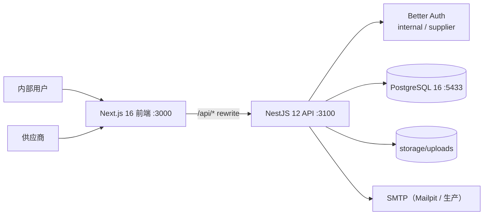

# 供应商微平台

面向内部采购/业务人员与外部供应商的询价协作平台，覆盖「供应商档案 → 询价 → 报价 → 选标 → 下单 → 合同往来 → 验收 → 发票/请款」链路，替代分散的邮件与线下表格。

- 需求与验收口径：[requirements.md](./requirements.md)（v1.6，单一事实来源）
- 工程文档索引：[docs/README.md](./docs/README.md)
- 架构 / 数据模型 / API / 页面：[docs/architecture.md](./docs/architecture.md)、[docs/data-model.md](./docs/data-model.md)、[docs/api.md](./docs/api.md)、[docs/pages.md](./docs/pages.md)
- 架构决策：[docs/adr/](./docs/adr/)

## 架构



| 部分 | 技术 | 目录 |
| --- | --- | --- |
| 前端 | Next.js 16 App Router、React 19、HeroUI v3、Tailwind CSS 4、TanStack Query | `supplier-microplatform-nextjs/` |
| 后端 | NestJS 12（ESM）、Prisma 7、Better Auth 1.7、Zod、ExcelJS | `supplier-microplatform-nestjs/` |
| 本地依赖 | PostgreSQL 16 + Mailpit（Docker Compose） | `dev-containers/` |
| 文档 | 架构、数据模型、API、页面、ADR | `docs/` |

## 目录结构

```
supplier-microplatform/
├── dev-containers/
│   └── docker-compose.yml      # 本地 PostgreSQL 16 + Mailpit
├── requirements.md             # 需求与设计开发方案（v1.6）
├── docs/                       # 工程文档与 ADR
├── supplier-microplatform-nestjs/
│   ├── prisma/                 # schema、migrations、seed
│   ├── scripts/                # ensure-database 等
│   └── src/                    # 模块、守卫、邮件、存储
└── supplier-microplatform-nextjs/
    ├── app/                    # 内部端 / 供应商端 / 公共页面
    ├── components/             # 布局、UI、表单、附件
    └── lib/                    # API 客户端、认证、格式化、下载
```

## 环境要求

- Node.js 24+
- pnpm 10+
- Docker（用于本地 PostgreSQL 与 Mailpit）
- 时区 `Asia/Shanghai`

## 快速开始

### 1. 启动本地依赖

```bash
docker compose -f dev-containers/docker-compose.yml up -d
docker compose -f dev-containers/docker-compose.yml ps     # 等 postgres 变为 healthy
```

| 服务 | 地址 |
| --- | --- |
| PostgreSQL | `127.0.0.1:5433`，用户 `postgres` / 密码 `prisma`，库 `supplier_microplatform` |
| Mailpit Web UI | http://localhost:8025 |

### 2. 启动后端

```bash
cd supplier-microplatform-nestjs
cp .env.example .env       # 按需修改密钥
pnpm install
pnpm db:deploy             # 或 pnpm db:migrate
pnpm db:seed               # 初始化管理员与基础设置
pnpm start:dev             # http://localhost:3100
```

默认管理员：`admin` / `Admin12345`（可用 `SEED_ADMIN_*` 覆盖）。

### 3. 启动前端

```bash
cd supplier-microplatform-nextjs
pnpm install
pnpm dev                   # http://localhost:3000
```

打开 http://localhost:3000 后：

- 内部端：`/login`
- 供应商端：`/supplier/login`（供应商账号由内部用户创建，初始密码在邮件或创建结果中）

### 4. 验证邮件

触发找回密码、创建供应商账号或发送询价后，打开 http://localhost:8025 查看邮件正文与附件。

## 测试与构建

提交前必须通过：

```bash
# 后端
cd supplier-microplatform-nestjs
pnpm lint
pnpm test          # vitest run
pnpm build

# 前端
cd supplier-microplatform-nextjs
pnpm lint
pnpm exec vitest run
pnpm build
```

## 常见问题

**端口被占用**

- PostgreSQL 默认映射到 `5433`（避免与本机 5432 冲突）。如需修改，同步更新后端 `.env` 的 `DATABASE_URL`。
- 前端 3000、后端 3100 被占用时，分别修改启动端口与前端 `API_PROXY_TARGET`。

**数据库结构与 Prisma Schema 不一致**

优先使用迁移：

```bash
cd supplier-microplatform-nestjs
pnpm db:generate
pnpm db:deploy
```

若本地库已有手工改动，先备份再按 `prisma migrate diff` 的结果对齐；不要在未确认的情况下清空数据卷。

**登录后立刻被跳转到改密页**

新账号 `mustChangePassword=true` 时会强制改密，改密成功后自动解除。管理员重置密码也会重新置为强制改密。

**登录返回 403「账号已停用」**

账号 `isActive=false` 或已删除时无法建立会话，请联系管理员启用账号。

**登录/找回密码返回 429**

认证接口有 60 秒 10 次的进程内限流，稍后重试即可。

**邮件没有收到**

本地默认发往 Mailpit（http://localhost:8025），不会投递真实邮箱。生产需配置 `MAIL_HOST` / `MAIL_PORT` / `MAIL_SECURE` / `MAIL_USER` / `MAIL_PASS`。

**供应商看不到询价**

供应商只能看到「被邀请且开放中」的询价；已关闭或已选标的询价通过「我的报价历史」只读查看。

**Next.js 动态路由构建报 Suspense 相关错误**

动态页面保持「Server Page + `<Suspense>` + `params.then(...)`」模式；内部端与供应商端 portal layout 已设置 `export const instant = false;`，不要移除。

**公开注册接口返回 404**

这是预期行为：平台不开放自助注册，账号必须由内部用户创建。
