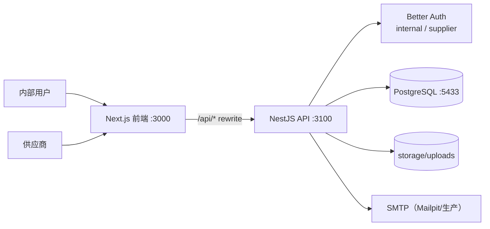
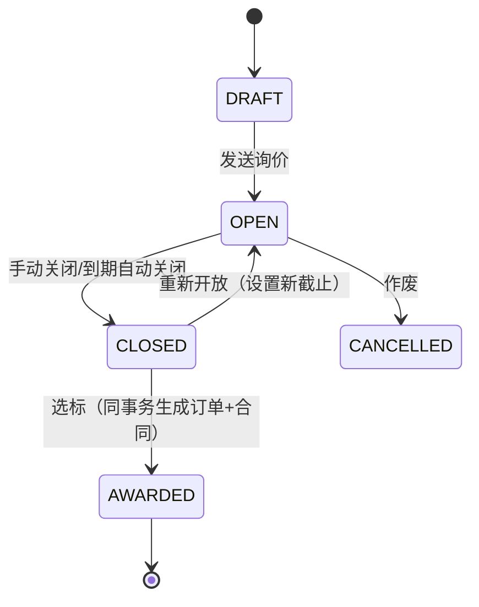

# 架构说明

> 对应需求：[总体架构](../requirements.md#2-总体架构)、[账号、角色与权限](../requirements.md#3-账号角色与权限)、[核心业务流程与状态机](../requirements.md#4-核心业务流程与状态机)、[非功能设计](../requirements.md#9-非功能设计)。

## 1. 总览

供应商微平台是前后端分离的 monorepo：

| 子项目 | 技术 | 职责 | 端口 |
| --- | --- | --- | --- |
| `supplier-microplatform-nextjs` | Next.js 16 App Router + React 19 + HeroUI v3 + Tailwind 4 | 内部端与供应商端全部页面、同源代理 | 3000 |
| `supplier-microplatform-nestjs` | NestJS 12（ESM）+ Prisma 7 + Better Auth 1.7 | REST API、鉴权、业务规则、邮件、文件 | 3100 |
| PostgreSQL 16 | Docker Compose | 业务数据与会话 | 5433 |
| Mailpit | Docker Compose | 本地邮件收件箱 | 1025 / 8025 |



## 2. 请求链路

1. 浏览器只访问 `http://localhost:3000`。
2. `next.config.ts` 将 `/api/:path*` 重写到 `API_PROXY_TARGET`（默认 `http://localhost:3100/api/:path*`）。
3. 浏览器与 Nest 同源，Better Auth 的 HttpOnly Cookie 直接生效，无需开发期 CORS。
4. 页面壳与布局使用 Server Component；登录态数据由 Client Component + TanStack Query 通过 `lib/api-client.ts` 获取。
5. 所有业务接口默认要求会话。公开接口仅登录、找回密码、重置密码；`/api/health` 用于健康检查。

## 3. 后端模块与目录

```
src/
├── main.ts                     # /api 前缀、注册封禁、认证限流、Better Auth 挂载、异常过滤器
├── app.module.ts
├── config/                     # Zod 环境变量校验
├── common/
│   ├── audit/                  # 审计日志服务
│   ├── decorators/             # @CurrentUser()、@Roles()
│   ├── errors/                 # AppException、错误码
│   ├── filters/                # 统一异常响应
│   ├── guards/                 # 内部/供应商/任意会话守卫、角色守卫
│   ├── interceptors/           # 成功响应包络
│   └── utils/                  # 分页、每日编号、时间
├── auth/                       # Better Auth 双实例、账号服务
├── mail/                       # MailService、模板、MailLog
├── storage/                    # 本地存储、签名下载
├── prisma/                     # PrismaService
├── modules/
│   ├── admin/                  # 用户、审计、邮件日志、系统设置
│   ├── dashboard/              # 内部/供应商工作台
│   ├── suppliers/              # 供应商、账号、可见范围、评级
│   ├── projects/
│   ├── inquiries/              # 含定时关闭任务
│   ├── quotes/                 # 报价、对比、Excel 导出
│   ├── orders/                 # 订单、合同、验收单、发票
│   └── settings/
├── me.controller.ts            # /api/me
├── supplier-me.controller.ts   # /api/supplier/me
└── health.controller.ts
```

约定：

- ESM：相对导入必须带 `.js`；使用 `import.meta.dirname`。
- 参数校验：Zod Schema + `StandardSchemaValidationPipe`（`@Body({ schema })`）。
- 控制器只做解析与权限编排，跨表写操作在 Service 内使用 `prisma.$transaction`。
- 业务错误统一抛 `AppException` + 错误码；全局过滤器转换为 `{ success:false, error, requestId }`。
- 成功响应由拦截器包装为 `{ success:true, data, meta? }`。

## 4. 认证与权限

### 4.1 双实例

- 内部：`/api/auth/internal/*`，表 `internal_user` / `internal_session`。
- 供应商：`/api/auth/supplier/*`，表 `supplier_user` / `supplier_session`。
- 两套账号、会话完全隔离；同一邮箱可同时存在于两套体系（ADR-001）。
- 登录标识：用户名或邮箱 + 密码（`emailAndPassword` + `username` 插件）。

### 4.2 会话防护

- `InternalAuthGuard` / `SupplierAuthGuard` 调用对应 Better Auth 实例的 `getSession`。
- 校验账号 `isActive` 与 `deletedAt`；停用账号在登录建立会话阶段即被拒绝（`databaseHooks.session.create.before`），已存在会话在业务请求时也被拒绝。
- `mustChangePassword=true` 时，除改密接口外返回 403 `PASSWORD_CHANGE_REQUIRED`。
- 前端会话失配：内部会话访问 `/supplier/*`、供应商会话访问内部路由均跳转 `/forbidden`。

### 4.3 权限规则

| 操作 | ADMIN | 创建者 MEMBER | 其他 MEMBER | 供应商 |
| --- | --- | --- | --- | --- |
| 内部用户管理 | ✅ | ❌ | ❌ | ❌ |
| 创建供应商/账号 | ✅ | ✅ | ✅ | ❌ |
| 编辑供应商、可见范围、账号 | ✅ | 自己创建的 | ❌ | ❌ |
| 查看项目 | ✅ | ✅ | ✅（共享） | ❌ |
| 编辑/归档项目、询价、选标 | ✅ | 自己创建的 | ❌ | ❌ |
| 标记订单完成、回传合同、签署验收单 | ✅ | 所属项目创建者 | ❌ | ❌ |
| 内部查看订单 | ✅ | ✅ | ✅ | ❌ |
| 供应商查看询价/报价/订单 | — | — | — | 仅自己企业且被邀请的数据 |

供应商可见范围：`ALL` 或 `SPECIFIED`（`supplier_visibility_user`）；创建者与管理员始终可见。

### 4.4 登录安全

- 公开注册已禁用：`/api/auth/*/sign-up*` 返回 404。
- `sign-in`、`request-password-reset`、`reset-password`、`forget-password` 按 `IP + 路径` 进程内限流（60 秒内最多 10 次），超限返回 429 `TOO_MANY_REQUESTS`。
- 测试发信接口 `/api/admin/mail/test` 按 IP 限流（60 秒内最多 5 次），超限返回 429。
- 新账号使用一次性初始密码，首次登录强制改密；改密成功由 `databaseHooks.account.update.after` 置 `mustChangePassword=false`。

## 5. 状态机



| 实体 | 状态 |
| --- | --- |
| 项目 | `ACTIVE` / `ARCHIVED`（归档后只读） |
| 询价项 | `DRAFT` → `OPEN` → `CLOSED` → `AWARDED`，可 `CANCELLED`；`CLOSED` 可重新开放 |
| 订单 | `PENDING_CONTRACT` → `IN_PROGRESS` → `COMPLETED`，可 `CANCELLED` |
| 合同 | `PENDING_SUBMISSION` → `SUBMITTED` → `RETURNED` → `COMPLETED`（线下签署完成可选） |
| 验收单 | `UPLOADED` → `SIGNED`（可选，不阻塞订单完成） |
| 发票 | 仅记录，无审核状态（ADR-007） |

关键不变式：

- 一个询价项最多一个订单（`order.inquiryId` 唯一）；选标在事务内完成订单与合同创建。
- 报价仅在 `OPEN` 且未过截止时可提交/修改；每次修改版本号递增。
- 订单完成后，服务端拒绝新的合同/验收单/发票提交；已上传的验收单仍可签署。

## 6. 文件与下载

- `StorageService` 抽象，本地实现写入 `STORAGE_DIR`。
- 上传先创建 `TEMP` 附件；提交业务时绑定 `scope`（PROJECT/INQUIRY/QUOTE/CONTRACT/ORDER/INVOICE/SUPPLIER）与 `scopeId`。
- 下载必须 `POST /api/files/:id/access-token` 获取 5 分钟签名 URL，再 `GET /api/files/:id/download?expires&signature`；签名由 `FILE_SIGNING_SECRET` 生成，校验会话与数据权限。
- 单文件上限 `MAX_UPLOAD_MB`（默认 20MB），超限 413。

## 7. 邮件

- `MailService` 基于 Nodemailer，模板集中在 `src/mail/mail-templates.ts`。
- 每次发信写 `mail_log`（状态、收件人、模板、错误信息）；失败不阻塞主流程，可在管理员邮件日志页重试。
- 本地默认投递到 Mailpit；生产通过 `MAIL_*` 环境变量切换真实 SMTP。

## 8. 审计与运维

- `audit_log` 记录关键操作：选标、合同回传/签署完成、订单完成/取消、账号创建/停用/重置、设置修改等。
- 管理员可在 `/admin/settings` 的「审计日志」标签页查询（接口 `GET /api/admin/audit-logs`）。
- 询价到期由 `@nestjs/schedule` 定时任务扫描并自动关闭。
- 金额使用 `Decimal(16,2)`，接口以字符串返回；时间统一 ISO 8601，展示时区 `Asia/Shanghai`。
