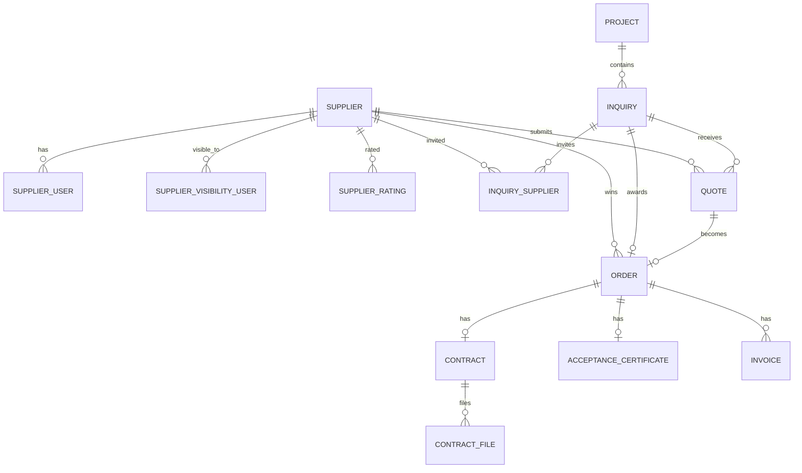

# 数据模型

> 对应需求：[数据模型设计](../requirements.md#5-数据模型设计)、[ADR-002](./adr/0002-prisma-relation-mode.md)。
> Schema 单一事实来源：`supplier-microplatform-nestjs/prisma/schema.prisma`。

## 1. 设计原则

- 主键统一 `cuid()` 字符串；业务编号另设唯一字段（`supplier.code`、`project.code`、`inquiry.code`、`order.orderNo`）。
- Prisma `relationMode = "prisma"`，不创建数据库外键，一致性由应用层与事务保证。
- 金额 `Decimal(16,2)`，数量 `Decimal(14,3)`，评分 `Decimal(3,1)`；接口以字符串返回，避免 JS 浮点误差。
- 时间使用 `DateTime`（UTC 存储），展示按 `Asia/Shanghai`。
- 软删除：账号使用 `isActive=false` + `deletedAt`；业务数据不物理删除，项目通过 `ARCHIVED` 冻结。
- 附件与业务分离：`attachment` 先以 `TEMP` 上传，提交时绑定 `scope/scopeId`。

## 2. 枚举

| 枚举 | 取值 | 用途 |
| --- | --- | --- |
| `InternalRole` | `ADMIN` / `MEMBER` | 内部用户角色 |
| `SupplierStatus` | `ACTIVE` / `DISABLED` | 供应商与供应商账号状态 |
| `VisibilityScope` | `ALL` / `SPECIFIED` | 供应商对内部用户可见范围 |
| `ProjectStatus` | `ACTIVE` / `ARCHIVED` | 项目状态 |
| `InquiryStatus` | `DRAFT` / `OPEN` / `CLOSED` / `AWARDED` / `CANCELLED` | 询价项状态 |
| `InviteMailStatus` | `PENDING` / `SENT` / `FAILED` | 询价邀请邮件状态 |
| `OrderStatus` | `PENDING_CONTRACT` / `IN_PROGRESS` / `COMPLETED` / `CANCELLED` | 订单履约状态 |
| `ContractStatus` | `PENDING_SUBMISSION` / `SUBMITTED` / `RETURNED` / `COMPLETED` | 合同往来状态 |
| `AcceptanceStatus` | `UPLOADED` / `SIGNED` | 验收单状态 |
| `AttachmentScope` | `TEMP` / `PROJECT` / `INQUIRY` / `QUOTE` / `CONTRACT` / `ORDER` / `INVOICE` / `SUPPLIER` | 附件归属 |
| `AttachmentKind` | `GENERAL` / `QUOTE_FILE` / `CONTRACT_FILE` / `ACCEPTANCE_FILE` / `SIGNED_ACCEPTANCE` / `INVOICE_FILE` / `PAYMENT_REQUEST` | 附件类型 |
| `UploaderType` | `INTERNAL` / `SUPPLIER` | 上传者类型 |
| `AuditActorType` | `INTERNAL` / `SUPPLIER` / `SYSTEM` | 审计操作者类型 |
| `MailStatus` | `PENDING` / `SENT` / `FAILED` | 邮件发送状态 |

## 3. 表清单

### 3.1 账号与会话（Better Auth）

| 表 | 关键字段 | 说明 |
| --- | --- | --- |
| `internal_user` | `email` 唯一、`username` 唯一、`role`、`phone`、`isActive`、`mustChangePassword`、`deletedAt` | 内部用户 |
| `internal_session` | `token` 唯一、`userId`、`expiresAt` | 内部会话 |
| `internal_account` | `userId`、`providerId`、`password` | 内部密码凭证 |
| `internal_verification` | `identifier`、`value`、`expiresAt` | 内部重置密码令牌 |
| `supplier_user` | `email`/`username` 唯一、`supplierId`、`title`、`isPrimary`、`isActive`、`mustChangePassword` | 供应商账号，绑定唯一供应商 |
| `supplier_session` / `supplier_account` / `supplier_verification` | 同内部 | 供应商会话、凭证、令牌 |

### 3.2 业务表

| 表 | 关键字段 | 关系与约束 |
| --- | --- | --- |
| `supplier` | `code` 唯一、`name`、`status`、`visibilityScope`、`ratingAvg`、`ratingCount`、`createdByUserId` | 供应商档案 |
| `supplier_visibility_user` | `supplierId`、`userId` | 唯一 `(supplierId,userId)`；`SPECIFIED` 时的可见用户 |
| `supplier_rating` | `supplierId`、`ratedByUserId`、`inquiryId`、三维评分、`score`、`comment` | 唯一 `(supplierId,ratedByUserId,inquiryId)`，重复评价为更新 |
| `project` | `code` 唯一、`name`、联系人三字段、`status`、`createdByUserId`、`archivedAt` | 项目容器 |
| `inquiry` | `code` 唯一、`projectId`、`title`、`quantity`、`unit`、`deadline`、`status`、`openedAt/closedAt/awardedAt` | 一个项目多个询价项 |
| `inquiry_supplier` | `inquiryId`、`supplierId`、`mailStatus`、`sentAt` | 唯一 `(inquiryId,supplierId)`；受邀供应商 |
| `quote` | `inquiryId`、`supplierId`、`unitPrice`、`totalPrice`、`currency`、`deliveryDays`、`validUntil`、`note`、`version` | 唯一 `(inquiryId,supplierId)`；修改时 `version+1` |
| `order` | `orderNo` 唯一、`projectId`、`inquiryId` 唯一、`supplierId`、`quoteId` 唯一、`amount`、`status`、`completedAt` | 一标一单；`inquiryId` 唯一兜底重复下单 |
| `contract` | `orderId` 唯一、`status`、`supplierNote`、`submittedAt/returnedAt/completedAt` | 订单创建时同步创建，初始 `PENDING_SUBMISSION` |
| `contract_file` | `contractId`、`attachmentId`、`direction`、`uploadedByType`、`uploadedById` | 合同多轮文件（供应商提交 / 内部回传） |
| `acceptance_certificate` | `orderId` 唯一、`status`、`supplierFileId`、`signedFileId`、签署人与时间 | 可选验收单，每单最多一条 |
| `invoice` | `orderId`、`supplierId`、`invoiceNo`、`amount`、`currency`、`note`、提交人 | 可多次提交；本期仅记录 |

### 3.3 支撑表

| 表 | 关键字段 | 说明 |
| --- | --- | --- |
| `attachment` | `scope`、`scopeId`、`kind`、`fileName`、`mimeType`、`size`、`storageKey`、上传者、`expiresAt` | 本地附件元数据；`TEMP` 可设置过期 |
| `audit_log` | `actorType`、`actorId`、`action`、`targetType`、`targetId`、`summary`、`beforeData/afterData`、`ip` | 关键操作审计 |
| `mail_log` | `templateKey`、`toEmails`、`subject`、`status`、`attempts`、`error`、`relatedType/relatedId`、`payload` | 邮件日志与重试 |
| `system_setting` | `key` 主键、`value` | 平台名称、地址、默认联系人等 |

## 4. 关系图



## 5. 一致性规则

1. **选标事务**：询价 `CLOSED` 且未定标 → 条件更新为 `AWARDED`，同时创建 `order` 与 `contract`；`order.inquiryId` 唯一约束防止重复下单。
2. **报价**：仅 `OPEN` 且 `now < deadline` 可提交；重复提交更新原记录并 `version+1`。
3. **订单完成**：仅项目创建者或管理员；完成后 `completedAt` 写入，服务端拒绝合同/验收/发票的新提交。
4. **验收单**：签署前可重传；签署后禁止替换；订单完成后仍可签署已上传验收单。
5. **发票**：订单未完成时可多次提交；不校验金额上限与重复发票号（ADR-007）。
6. **评级聚合**：`supplier.ratingAvg` 与 `ratingCount` 在评价写入后按最新评分重算。
7. **归档**：项目 `ARCHIVED` 后所有写操作被服务端拒绝，页面只读。

## 6. 迁移与种子

```bash
cd supplier-microplatform-nestjs
pnpm db:generate     # 生成 Prisma Client 到 src/generated/prisma
pnpm db:ensure       # 确保数据库存在
pnpm db:migrate      # 开发：创建/应用迁移
pnpm db:deploy       # 生产/CI：应用已有迁移
pnpm db:seed         # 初始化管理员与基础设置
pnpm db:studio       # 可视化查看数据
```

- 迁移目录：`prisma/migrations/`。
- 种子：`prisma/seed.ts`，使用 `SEED_ADMIN_*` 环境变量创建或修正管理员。
- 修改 Schema 后必须重新 `db:generate`，否则类型与运行时不一致。
